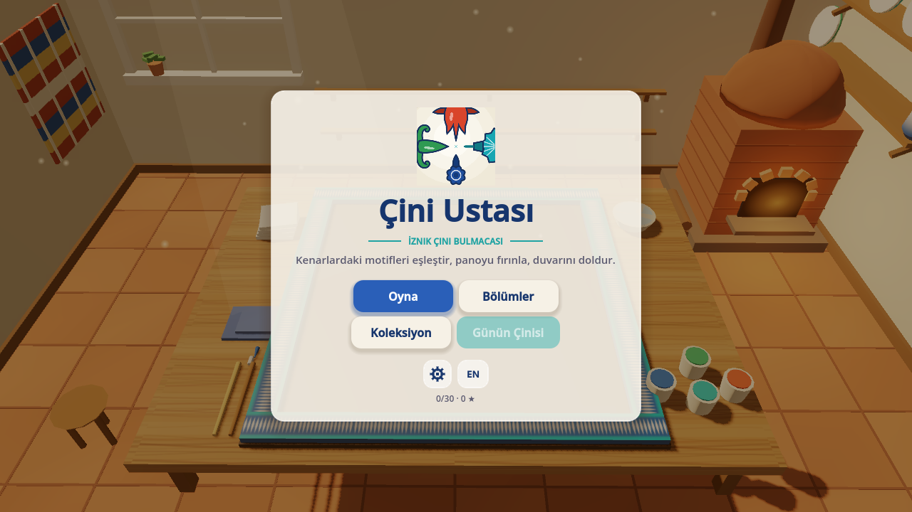
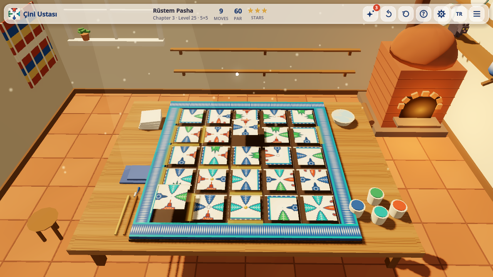
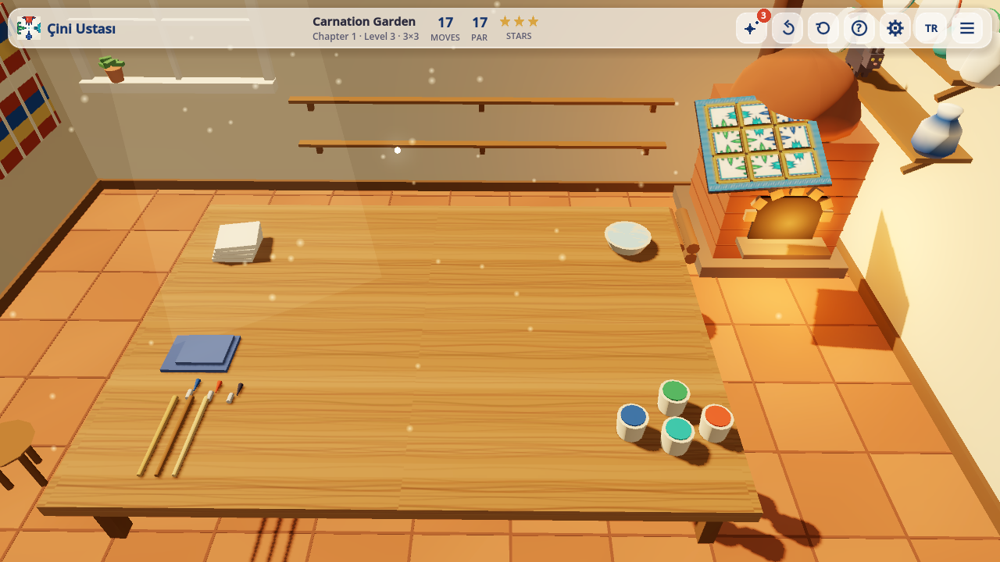
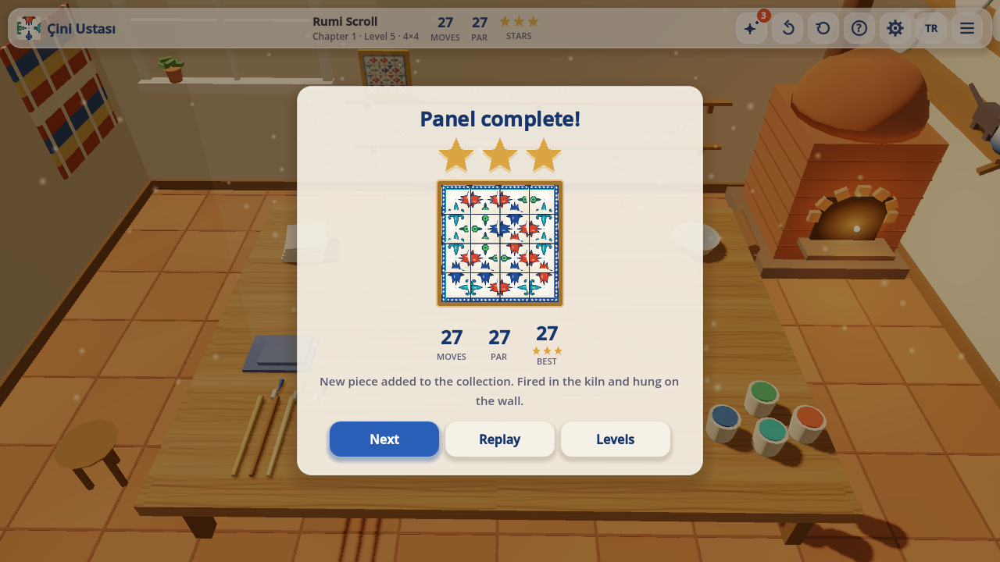
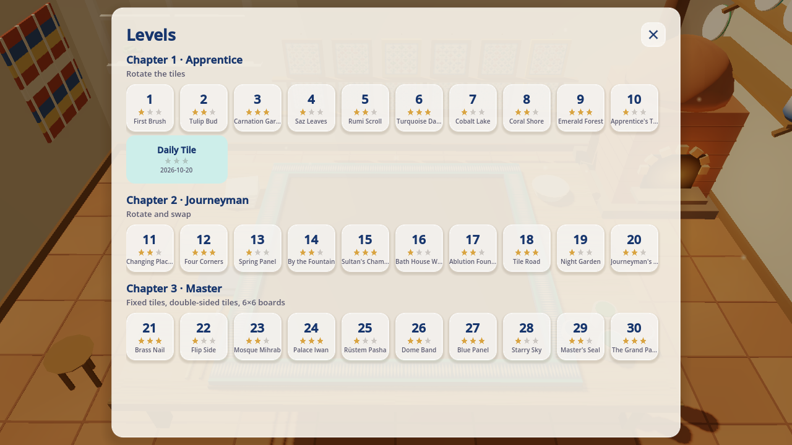
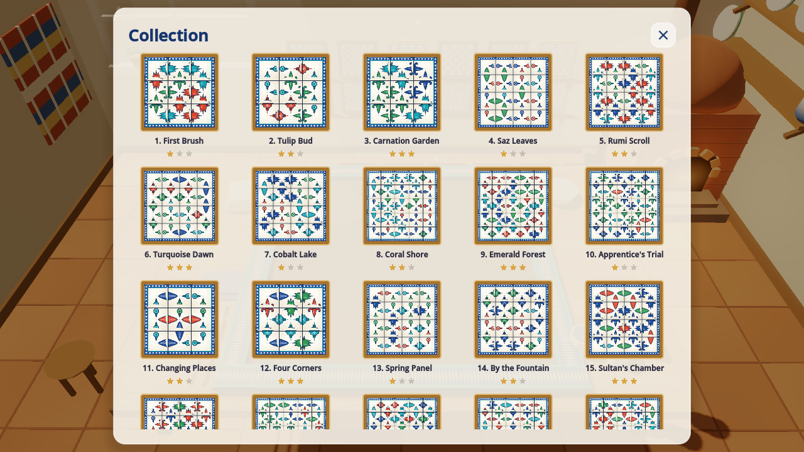
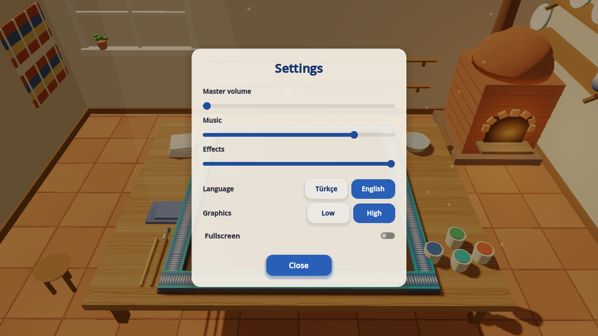
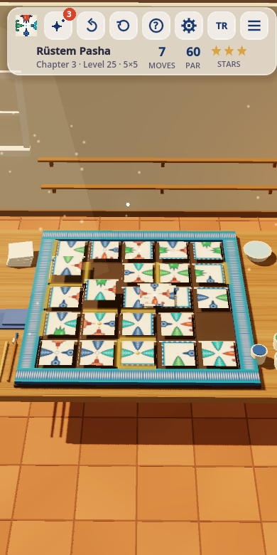

# 🏺 Çini Ustası · Iznik Tile Puzzle (Godot 4)

**[▶ Play in your browser](https://furkiozknn.github.io/cini-ustasi-godot/)** · Türkçe & English · desktop & mobile · free, no install

🏟️ Part of **[Claude Game Arena](https://github.com/Furkiozknn/claude-game-arena)**, round 2: every model remakes its own
round-1 browser game in Godot 4. This one was rebuilt by **Claude Fable 5.1** from its Three.js original,
[Çini Ustası](https://github.com/Furkiozknn/cini-ustasi). [See all games and the scorecard →](https://furkiozknn.github.io/claude-game-arena/)

A calm 3D edge-matching puzzle set in a warm tile workshop. Rotate, swap and flip hand-painted Iznik
tiles until every tulip, carnation, saz leaf, rumi scroll and rosette connects across the board, then
watch the finished panel glaze, fire in the kiln and take its place on your wall.

This is the Godot 4 remake of the round-1 browser game (Three.js, single `index.html`) built for the
Claude Game Arena. Same rules, same 30 levels and names, same Turkish/English texts, now on a real engine:
real materials and a shadowed light, a tonemapped and fogged environment, particles, a save system,
settings, data-driven levels and a headless test suite.

| | |
|---|---|
|  |  |
|  |  |
|  |  |
|  |  |

The screenshots in `docs/` are Movie Maker frames rendered by the game itself (see below).

## Features

- **30 levels in 3 chapters** (Apprentice / Journeyman / Master), each adding a mechanic: rotate, then
  swap, then fixed tiles, double-sided tiles and 6×6 boards. Plus a **Daily Tile** (4×4) that unlocks
  after chapter 1.
- **Every board is guaranteed solvable**: generated solved, then scrambled with a deterministic seed.
  The built-in backtracking solver powers hints and the autoplay bot; the tests solve all 30 levels.
- **Hand-painted motifs drawn in code**: five Iznik motifs in cobalt, turquoise, coral and emerald,
  rendered into a per-level texture atlas with Godot's 2D drawing API (no image files in the repo).
- **Moves vs par, 1-3 stars**, undo, restart, three hints per level, best results per level.
- **The kiln sequence**: a solved board glows, a glaze sweep shines across it, it lifts into the kiln
  while the camera pans along (fully in portrait, where the kiln is otherwise off-screen), fires with
  sparks and a camera shake, and the framed panel swings out to the gallery wall.
- **A living workshop**: dust motes in the window light, a flickering kiln, a cat on the shelf, a
  gently drifting camera, 3D shadows, fog and filmic tonemapping (Compatibility renderer, runs on
  integrated GPUs and in the browser).
- **Synthesised audio**: an oud-like generative music loop on a Hicaz scale with a drone and a delay
  bus, plus clicks, chimes, the kiln's whoosh and a fanfare, all generated at start-up in GDScript.
- **Menus with transitions**, pause, **settings** (master/music/effects volume, language TR/EN, quality
  low/high, fullscreen), toasts, a collection gallery and a level select with stars.
- **Save system** in `user://` (progress and settings as JSON / ConfigFile), tolerant to malformed data.
- **Data in resources**: levels, chapters and the palette live in `.tres` files under `resources/`.

## Controls

| Action | Mouse / keyboard | Touch | Gamepad |
|---|---|---|---|
| Rotate a tile 90° | Click | Tap | — |
| Swap two tiles (chapter 2+) | Drag one onto the other | Drag | — |
| Flip a double-sided tile (chapter 3) | Right-click or `F` on the hovered tile | Long-press | X |
| Tilt the camera / zoom | Drag on the table / mouse wheel | Drag / pinch | — |
| Undo / hint / restart | `Z` / `H` / `R` | Top bar | B / Y |
| Menu / back | `Esc` | Top bar | Start |
| Switch language | `L` or the EN/TR button | Button | — |

All bindings live in the Input Map (`project.godot`).

## Run

Requires Godot 4.7.2 (standard build, no C#).

```text
godot --path .                      # play
godot --path . -- --auto            # watch the bot play the whole game
godot --path . -- --level 22 --lang en
```

### Tests

```text
godot --headless --path . --scene res://tests/run_tests.tscn
```

Prints one final line, `TESTS PASSED n/n` or `TESTS FAILED k/n`, and exits with code 0 or 1.
The tests cover the RNG and hash references, level generation validity for all 30 levels, the
evaluator, move planning, the solver (all levels and several daily boards), hints, scoring, the
progress format and the GameState flow. They never touch the player's save data.

### Autoplay bot

```text
godot --headless --path . -- --auto --no-save --quit-on-done --speed 8
```

Prints `BOT DONE levels=30 stars=90 errors=0` and the final `GameState.get_state_text()` JSON.

### Movie Maker (visual check without export templates)

```text
godot --path . --write-movie %TEMP%\frames\f.png --fixed-fps 30 --quit-after 300 -- --auto --no-save --level 3 --solve
```

For a 390×780 portrait check, temporarily add an `override.cfg` next to `project.godot`:

```ini
[display]
window/size/viewport_width=390
window/size/viewport_height=780
```

## User arguments (after `--`)

| Argument | Effect |
|---|---|
| `--auto` | The bot solves every level with the real solver and moves on through the whole game |
| `--solve` | With `--auto`: apply the whole solution at once (jump straight to the kiln sequence) |
| `--quit-on-done` | With `--auto`: exit with code 0 when done (1 if the bot hit an error) |
| `--stop-after N` | With `--auto`: stop after level N (0-based index) |
| `--no-save` | Never read or write `user://` (fresh in-memory progress and settings) |
| `--fill` | Start with all 30 levels completed (collection and gallery full) |
| `--level N` / `--level daily` | Jump straight into a level |
| `--screen levels\|collection\|settings\|howto\|pause` | Open a screen at start (`--ch N` picks the how-to chapter) |
| `--lang en\|tr` | Interface language |
| `--quality low\|high` | Graphics quality for this run |
| `--speed X` | `Engine.time_scale` (fast-forward for bot runs) |
| `--nohowto` | Skip the chapter how-to cards |
| `--mute` | Silence the audio and skip sample synthesis |
| `--debug` | Draw calls, fps, state and bot status overlay |

`GameState.get_state_text()` returns the whole game state as JSON (screen, level, moves, par, stars,
hints, slots, progress summary, bot status).

## Project layout

```text
scenes/main.tscn            main scene (everything is built in code from main.gd)
scripts/autoload/           Loc (TR/EN strings), Settings, GameState (rules + progress), Audio (synth)
scripts/core/               pure puzzle logic: RNG, generation, evaluation, solver, moves
scripts/data/               Resource classes: LevelDef, ChapterDef, LevelSet, PaletteDef
scripts/render/             motif painter, texture baker (SubViewport), tile mesh, mesh builder
scripts/game/               world builder, board, tiles, camera, kiln sequence, gallery, cat, input, bot
scripts/ui/                 theme, HUD, screens, toasts
resources/                  levels/*.tres, chapters/*.tres, level_set.tres, palette.tres
tests/run_tests.tscn        headless test runner
export_presets.cfg          "Web" preset (threads off, VRAM compression desktop + mobile)
```

## Web export

The `Web` preset exports to `build/web/index.html` with thread support off (so it works on GitHub
Pages without cross-origin isolation headers) and VRAM texture compression for desktop and mobile.
No editor step is needed: `godot --headless --path . --export-release Web build/web/index.html`.

## How it was made

Round 2 of a series in which **every game is built by a different AI model**. Each model gets the same brief,
[`prompts/godot-remake.md`](https://github.com/Furkiozknn/claude-game-arena/blob/main/prompts/godot-remake.md):
remake your own round-1 game in Godot 4.7 (GDScript, Compatibility renderer) and make it better, not just equal.
This one was built by **Claude Fable 5.1** (`claude-fable-5-1`) with [Claude Code](https://claude.com/claude-code).
The orchestrating session re-ran the checks independently before release:

- `TESTS PASSED 21/21`, clean headless import (no errors or warnings).
- The `--auto` bot solves every level: `BOT DONE levels=30 stars=90 errors=0`.

The web build is exported on GitHub's servers by [`.github/workflows/pages.yml`](.github/workflows/pages.yml)
(pinned, checksum-verified Godot 4.7.2 and export templates) and published to GitHub Pages.

## License

Code: MIT. All art and audio are generated procedurally by the code in this repository.
